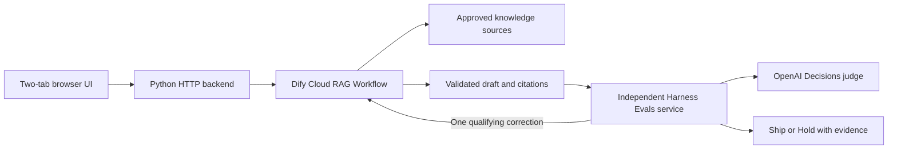

# Dify project toolkit

A documentation-based ticket chatbot and an independent Harness Evals dashboard that explain whether an answer should **Ship** or **Hold off**.

A convincing answer can still use the wrong API key, invent policy, or miss the customer's concern. This project retrieves approved documentation, generates a draft, then checks its evidence and relevance separately. The supplied fictional guide establishes demo policy; the 26-ticket CSV contains noisy answers to evaluate, not knowledge to memorize. Start with the [project guidelines](docs/PROJECT_GUIDELINES.md) and [recorded evaluation evidence](evals/evidence/README.md).

## Review the complete flow

1. In **RAG bot**, select a CSV ticket and click **Draft answer**. Inspect the answer and retrieved source passages.
2. Click **Evaluate this response** to open **Eval bot**. Review its score, ranked dimensions, failed gates, citations and recommendation.
3. A qualifying borderline answer receives one correction. The dashboard retains both attempts, initial/final scores and generation/scoring retry flags.

Ship is provisional eligibility, not authorization to contact a customer. No automatic ticket delivery is implemented; `delivery_approved=false` until human rubric approval and judge calibration.

## Architecture and runtime stack



| Component | Implemented technology |
|---|---|
| UI | Plain HTML, CSS and JavaScript; no frontend framework |
| Backend/integrations | Python 3.12; standard-library HTTP server, `urllib`, `json`, `csv`, `hashlib` |
| Generation | Published Dify Cloud Workflow; `gpt-4.1-mini` |
| Retrieval | High Quality VECTOR, `text-embedding-3-small`, `qwen3-rerank`, Top K 5 |
| Semantic evaluation | OpenAI Decisions REST API, `gpt-6-luna`; direct `urllib`, no OpenAI SDK |
| Evaluation execution | `harness-evals==0.25.3` |
| Contracts | JSON Schema documents plus Python boundary validators |
| Operations/checks | Docker Compose, Make, Git, Python `unittest`, Node's built-in test runner |

Codex specialist agents and browser automation helped build and verify the project. They are development tools, not dependencies that execute customer requests.

### The six-node Dify Workflow

The [actual Workflow export](agents/workflows/support-ticket-rag.yml) implements:

1. **User Input:** original `ticket_text`; optional diagnostic `evaluation_feedback`, maximum 8,000 characters.
2. **Knowledge Retrieval:** query the raw ticket against the approved corpus, with vector retrieval and reranking.
3. **Normalize Evidence:** accept only actual retrieved passages matching frozen approved paragraphs; attach stable evidence IDs, section IDs and source SHA-256 revisions.
4. **LLM:** generate structured `answer`, `category`, `disposition`, and `cited_evidence_ids` from that evidence.
5. **Resolve Citations:** reject invented IDs and resolve selected IDs to validated source records.
6. **Output:** return `answer`, `category`, `disposition`, `evidence`, and `citations`.

The corpus contains the fictional [product guide](knowledge/sources/product-guide.md) and a narrow [API transport supplement](knowledge/sources/api-transport-supplement.md). The supplement supports Bearer authorization/backend transport; it cannot override fictional policy. CSV answers stay outside the knowledge base. There is no separate live sentiment or keyword classifier: retrieval precedes the LLM's category selection. The local extractive fallback uses a simpler lexical router and quotes approved passages.

## How the Eval bot grades an answer

The judge receives the original ticket, drafted required/prohibited claims, acceptable dispositions, category taxonomy, answer/category/disposition and actual evidence. It sends ten named questions to `/v1/decisions`: six score questions and four predicates. Parsing rejects incomplete, duplicated, malformed or invalid judgments.

| Dimension | Weight | Criterion |
|---|---:|---|
| Grounding | 30% | Substantive claims follow the supplied evidence |
| Factual correctness | 25% | Documented conditions and policy remain correct; no invented diagnosis |
| Concern relevance | 20% | Address the actual operation and entity, including credential scope |
| Completeness | 15% | Handle every concern or clarify/escalate what evidence cannot resolve |
| Category accuracy | 5% | Match the actual concern and bounded taxonomy |
| Clarity | 5% | Direct, understandable and usable; no diagnostics or unrelated prose |

Each score question has five ordered levels: **0** fails/contradicts; **1** major errors; **2** partially meets; **3** mostly meets with minor correction needed; **4** fully meets. [OpenAI Decisions](https://developers.openai.com/api/docs/guides/decisions) returns a probability-weighted level index, which can be fractional. Divide it by four to normalize to 0–1, then calculate:

```text
quality = .30×grounding + .25×correctness + .20×relevance
        + .15×completeness + .05×category + .05×clarity
```

Four mandatory semantic predicates must each have probability **at least 0.90**: `supported`, `correct_scope`, `addresses_requested_concern`, and `appropriate_disposition`. Deterministic validators separately check source revision hashes, exact excerpt membership, citation references, output structure and explicit known regressions. Their binary rule score is **0 or 1**; 1 does not certify semantic correctness.

Harness Evals creates a `Golden` containing draft expected claims/evidence, an `EvalCase` containing the actual answer, a custom `SafetyMetric` for rules and six `BaseMetric` implementations; `evaluate` produces `Score` records. These expectations are not approved gold. Individual metric thresholds of 0.80 are diagnostic; every dimension need not independently exceed 0.80. The Python [scoring policy](agents/evals/scoring_policy.json) applies the weighted score and mandatory gates:

| Condition | Final behavior |
|---|---|
| Missing judge/invalid score/any failed gate | Hold off |
| Score below 0.70 | Hold off immediately |
| 0.70 ≤ score < 0.80, all gates pass | Exactly one correction, then Ship or Hold |
| Score ≥ 0.80, all gates pass | Provisional Ship |

A repeated unchanged answer, no improvement, or a correction still below 0.80 holds. Feedback is diagnostic data, never new facts or a target score; the rubric stays fixed. Evaluation is cached by draft ID to prevent judge rerolls. JSON/CSV/Markdown reports retain lowest-ranked dimensions, weights/contributions, gate failures, decision reasons, attempts and judge-call/retry counts. Reasons currently explain rubric criteria and failed gates; model-written freeform score explanations are not implemented.

## Verified evidence and limits

Marcus's app-key answer improved from **0.653 Hold to 0.930 Ship** after adding retrieved transport evidence. Sam's fresh dataset-key regression scored **0.991 Ship**; Priya's provider-setup answer scored **0.552 Hold** for missing steps. The 26 existing CSV answers yielded **7 Ship / 19 Hold**, including all eight known errors held. Baseline evaluation uses rubric reference evidence rather than runtime retrieval.

A separately labelled scheduling fixture used synthetic **0.75** solely to exercise one correction: two real generations and judgments scored **0.9305 → 0.967375**, with feedback verified inside Dify's LLM trace. It is excluded from the benchmark; a naturally triggered live borderline retry remains unobserved. See [recorded evidence](evals/evidence/README.md). Checks passed: **93 Python tests, 10 frontend tests**, compilation, Docker build and container round-trip, including the submission archive build. These checks do not prove the 95% resolution target or production safety.

## Setup, run and configuration

Install Python, Node/npm and Docker. From this repository:

```sh
make setup
```

For live generation, import the Workflow export into your own Dify Cloud workspace, configure model providers, create/index both approved sources, bind Knowledge Retrieval to your knowledge base and publish. Preserve the guide upload filename `Constructed fictional product documentation for the RAG knowledge base.md` and supplement filename `api-transport-supplement.md`; normalization validates filenames. Follow the [Workflow instructions](docs/PROJECT_GUIDELINES.md#live-workflow-structured-output).

Edit local `.env` with both API base URLs set to `https://api.dify.ai/v1`, `RAG_MODE=dify`, `EVAL_MODE=decisions`, your published `DIFY_APP_API_KEY`, and local `OPENAI_API_KEY`. The provider key saved inside Dify is separate from this local evaluator key. Keys remain server-side; never commit them. Live calls consume provider credits.

```sh
docker compose up -d --build
```

Open [Ticket desk](http://127.0.0.1:8080). Default `extractive`/`offline` modes work without keys; semantic scores remain unrun and all responses held. Inspect recorded reports for real scores without making live calls.

```sh
make test PYTHON=.venv/bin/python
make check PYTHON=.venv/bin/python
npm --prefix frontend run check
make logs
docker compose down
```

For development: `make dev PYTHON=.venv/bin/python`. For reports: `.venv/bin/python scripts/run_evaluations.py --source baseline` or `--source chatbot`. Rebuild after source changes. See [quickstart](starter-kit/QUICKSTART.md), [environment reference](starter-kit/ENVIRONMENT.md), and optional [self-hosting](docs/DIFY_LOCAL_SETUP.md).

## Tools, skills and repository

`python3 scripts/dify_api.py --help` exposes app metadata, blocking generation and knowledge operations with credential-free `--dry-run` previews. It reads process environment, while the web app centrally loads `.env`. Separate `DIFY_KNOWLEDGE_API_KEY` credentials serve knowledge operations. Redirects and automatic POST retries are rejected; streaming and console authoring require other integrations.

Five project-local [.agents/skills](.agents/skills/) cover Workflow design, Service API, knowledge, plugins and self-hosting. Four [worker briefs](agents/workers/) are portable role instructions, not automatic agent registration. See [resource map](docs/RESOURCE_MAP.md) and [adoption guide](docs/ADOPTION.md). Native Dify skills, Codex skills and plugins are distinct formats.

| Directory | Responsibility |
|---|---|
| `backend/`, `frontend/` | HTTP services, integrations and two-tab UI |
| `agents/`, `shared/` | Workflow, prompts, evals and canonical contracts |
| `knowledge/`, `evals/` | Approved sources, ticket cases and evidence |
| `docs/`, `starter-kit/`, `reviewer-kit/` | Rulebook, setup and reviewer guidance |
| `scripts/`, `tests/` | API tools and software checks |

Next: independently approve case rubrics, calibrate the judge and evaluate a fresh holdout before enabling delivery. The broader reasoning harness remains a [design target](docs/HARNESS_DESIGN.md), not a claim that every proposed stage is implemented.
