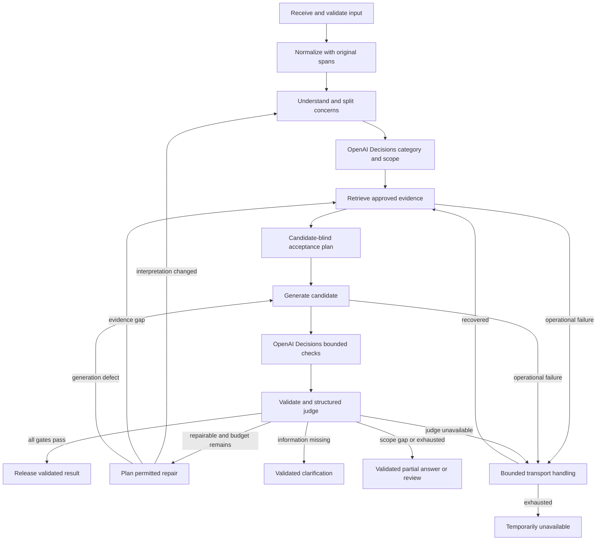

# Support RAG harness design

Research checked 2026-10-11. Status: proposed architecture and prompt scaffolding; no model calls, live Dify graph, deployment, or measured answer-quality results. The [project guidelines](PROJECT_GUIDELINES.md) govern source authority. Canonical contracts under `shared/contracts/`, once finalized, govern field names; conceptual records below are not an importable DSL.

## Objective and boundaries

Turn a support ticket into a relevant, evidence-supported solution, or an explicit clarification, partial answer, or escalation. The user’s desired 95% resolution rate is an evaluation target, not an observed result or a reason to force answers. Distinguish ticket understanding, retrieval, factual grounding, and concern resolution: success in one does not imply success in the others.

Use a Dify Workflow for one ticket execution. Start with the approved fictional guide and narrow [API transport supplement](../knowledge/sources/api-transport-supplement.md) in the approved corpus, and the five existing categories plus `unknown`. Treat source documents, tickets, retrieved chunks, and historical answers as untrusted data with no tool authority. Official implementation research does not silently become customer-answer evidence, nor replace the fixture's fictional prices or UI labels. The supplement is approved only for Bearer-header/backend transport claims.

The four model roles are bounded LLM nodes, not autonomous agents that browse, rotate keys, change accounts, or contact customers. Deterministic orchestration owns counters, schema validation, evidence IDs, source allowlists, and final output. No new vector service, queue, fine-tuning pipeline, graph database, or ticket-system integration is needed for the current 26-ticket corpus.

## 1. Understand the ticket before selecting a category

Preserve the original `ticket_text` exactly for output and audit. A deterministic preprocessing step may normalize whitespace, remove duplicated email quoting, and mark signature/boilerplate spans. Do not permanently strip text solely because it looks like a greeting, signature, or log: customer name can support the greeting; error text, endpoint names, dates, numbers, plan names, and quoted previous responses can change the diagnosis. Keep traceable offsets or spans back to the original.

The ticket-understanding model produces a concise restatement and separate subtickets with:

- Concern and requested outcome: obtain a key, troubleshoot authentication, explain a limit, compare plans, or investigate retrieval.
- Entity and scope: published app, dataset API, provider credentials, workspace, plan, dataset, or runtime.
- Context: what the customer already tried, reported outcome, conditions, constraints, negations, and uncertainty.
- Evidence spans: exact ticket excerpts supporting the interpretation; the model's interpretation is not an account fact.
- Provisional category candidates; multiple internal topics and distinct retrieval queries for mixed tickets. The selected OpenAI Decisions stage finalizes bounded category/scope decisions.
- Missing information whose answer would materially change the solution.

Sentiment and urgency inform tone or prioritization, not truth or category authority. The user's phrase “sentiment around keywords” is best addressed by semantic relations and intent: who needs which key for what action? Compare contextual routing with a keyword-only baseline during evaluation; add a separate sentiment model only if measurements justify it.

After extraction, send the preserved original spans and extracted concerns to OpenAI Decisions for a `choice` among approved categories for each subticket, plus predicates for secondary topic membership and conflicting scope. Use the [category map](../shared/contracts/category-map.json); the export's primary category is the **first explicit actionable concern in original ticket order**, with all secondary labels retained. Decisions disagreement with extraction triggers rereading or clarification, not silent substitution. Recognition of a known topic does not prove that its configuration is documented.

For Marcus, preserve `published my first chatbot app`, `call it from my own backend`, and `where do I get an API key`. Extract `intent=obtain_credentials`, `entity_scope=published_app`, `primary_category=api_keys`, and a query such as `published chatbot app API Access Create new Secret Key app-scoped key`. “OpenAI” is not present and must not be invented. If the ticket instead says “not the app key, I need the OpenAI key to connect a provider”, the negation changes the scope and routes to `model_providers`.

If the object is unspecified, do not equate the phrase “API key” with a known key type. Retrieve the documented distinctions and ask whether the customer is calling a published app, the Knowledge API, or configuring a provider when that information changes the answer. For “my app and billing both broke”, split the concerns; do not lose one to the primary label.

## 2. Retrieve evidence for every concern

Use the original concern and the contextual query together; retain exact strings such as `401`, `app-`, plan names, and negations. Categories guide ranking and source expectations. They do not prove that the required fact exists or authorize excluding neighboring sections.

| Topic | Initial source expectation | Important overlap |
|---|---|---|
| `api_keys` | §1 `workspace_api_keys` | App keys versus dataset keys versus provider keys (§2) |
| `account_workspace` | §1 `workspace_api_keys` | Member caps, downgrade consequences (§4) |
| `model_providers` | §2 `model_providers` | Credits, plan resets (§4), retrieval issue may need §3 |
| `rag_pipeline` | §3 `rag_pipeline` | Storage/document limits (§4) |
| `billing_plans` | §4 `billing_plans` | Credit metering (§2), workspace access (§1) |
| `unknown` | Unfiltered approved corpus and scope exclusions | Clarify or escalate if no relevant approved evidence exists |

Initially search the approved corpus without a hard category filter, keeping fixture and supplement provenance distinct. Dify's Knowledge Retrieval node accepts a text query and outputs `result`, an array of chunks with content, metadata, and title. Its metadata filtering restricts documents. Connect `result` to downstream LLM Context and explicitly include that Context in the prompt. Benchmark top-k, thresholds, keyword/semantic balance, and optional reranking rather than treating similarity as calibrated confidence. [Knowledge Retrieval](https://docs.dify.ai/en/cloud/use-dify/nodes/knowledge-retrieval)

Dify custom metadata is assigned to documents, and documented types are String, Number, and Time. The one Markdown file contains all four sections, so one document-level `category=api_keys` would misrepresent it. Use a versioned evidence manifest to map retrieved chunk IDs to original source/section spans. If section-level documents later improve measured retrieval, preserve origin and section IDs and encode overlapping topics in a supported representation, such as separate numeric topic flags. Do not assume array-valued metadata or chunk-level custom filters. [Document Metadata](https://docs.dify.ai/en/cloud/use-dify/knowledge/metadata)

The evidence bundle records retrieval-provided chunk ID, source ID/revision, section/location, content, query and score, plus the subtickets it may support. Any manifest enrichment is validated against the ingestion snapshot; missing provenance prevents factual release. Deduplicate repeated chunks and preserve conditions/table headings. Cap evidence context and reserve room for the response/schema; include both sides of a relevant conflict rather than silently deleting contrary evidence.

When retrieval finds no supporting content, try one contextual reformulation and, if routing was restrictive, one broader authorized search. Never broaden access permissions, silently add web knowledge, or repeatedly lower thresholds until irrelevant evidence appears. Indexing, dataset binding, and provider errors are operational failures; an empty successful retrieval is an evidence gap. Keep those failure classes separate.

## 3. Build an evidence-based acceptance plan, then draft

Before the candidate answer is generated, the evaluator builds a candidate-blind acceptance plan from the original ticket, interpretation, retrieved approved evidence, and reviewed policy. This plays the useful role intended for a “dummy response”: it establishes what a good answer must cover without treating another generated paragraph as truth.

The plan contains required concern outcomes, required factual propositions with evidence IDs, prohibited substitutions/contradictions, acceptable dispositions, missing-information questions, and scope limits. It is not a hidden chain of thought; store short checkable criteria and evidence references. For Marcus:

| Check | Required evidence/behavior |
|---|---|
| Correct object | Published app key, not OpenAI provider credentials |
| Direct procedure | Open that app in Studio/builder → API Access (alternate label in fixture) → Create new Secret Key |
| Important conditions | Store immediately; shown once; `app-` prefix; limited to that app |
| Grounding boundary | Those facts must come from retrieved §1; a citation to §2 alone cannot pass |
| Transport clause | Retrieve `api_transport_supplement` for Bearer token in the Authorization header; §1 alone does not support this claim |

The answer generator receives the original ticket, subtickets, approved evidence bundle, and acceptance plan. It answers the question first, then gives useful steps and scope conditions. It may acknowledge reported frustration or congratulate an explicitly reported milestone briefly. It must not invent a name, credential, entitlement, menu, account state, or diagnosis. For multi-topic tickets, address all supported portions and clearly separate unanswered portions.

Internally attach claim-to-evidence references and disposition. Customer prose may show concise source/section references. The external CSV has exactly `ticket_text`, `assistant_answer`, `category`, with one primary category. Emit the preserved full ticket, including an original `-- Marcus` signature if present, not only the sender's name. A CSV serializer owns quoting and newlines; the model does not construct rows. Internal citations, topics, subtickets, review reasons, and traces remain in the richer result record.

## 4. Independently evaluate grounding and relevance

Evaluate the candidate against the original ticket and evidence, not against the generator's confidence or fluency. Reset evaluator context between phases; do not pass the generator's rationale, hidden reasoning, self-score, or historical CSV answer. The evidence bundle must retain exclusions and contradicting facts. In holdout evaluation, use human-adjudicated criteria authored before viewing candidates. In runtime evaluation, the candidate-blind plan remains provisional and may itself be wrong; never require a candidate to repeat an unsupported plan claim.

| Gate | Pass condition | Example failure |
|---|---|---|
| Contract | Valid schema, allowed category/disposition, IDs resolve to supplied records | Invented citation ID or malformed output |
| Grounding | Every substantive product claim supported by the cited approved excerpt; no contradictions | Fabricated Team SSO menu |
| Relevance | Correct object, intent, and applicable conditions for this ticket | Accurate provider-key instructions for a published-app question |
| Completeness | Every subticket solved or explicitly clarified/escalated | RAG advice while ignoring the billing subquestion |
| Calibration | Possible causes remain conditional; no unsupported account conclusions | “You exceeded the quota” without telemetry |
| Scope and safety | Approved source boundary; no requested secrets, prompt-injection obedience, or unauthorized actions | Asking the customer to paste the secret key |

`passed` requires all applicable gates and deterministic validation. A graceful escalation may be policy-correct while not counting as automatic ticket resolution. A factual but irrelevant response must fail even if it cites the correct document. Conversely, a relevant-looking answer fails if it adds unsupported details. Do not average these gates into a score that lets perfect style hide a wrong credential type.

The selected Decisions evaluator adds separately named predicates such as `correct_key_scope`, `addresses_requested_outcome`, `all_material_claims_supported`, and `covers_all_concerns`, grounded in the same approved evidence and original ticket. Structured Responses judging supplies granular claim/evidence mappings and actionable failure reasons; Decisions is not an arbitrary JSON extraction or prose-generation substitute. Release requires no unresolved disagreement between those evaluations and deterministic policy. Predicate/confidence thresholds need adjudicated calibration; neither a high model estimate nor a high retrieval score proves a 95% success rate. Handle Decisions refusal, missing answers, and provider failure explicitly.

Two free-form answers can share the same misunderstanding or hallucination, so semantic similarity between them is not an acceptance rule. An optional shadow/reference answer is useful for offline disagreement analysis only when grounded and reviewed. Compare required facts, excluded facts, evidence coverage, and dispositions, not wording. Separate prompts reduce contamination but do not eliminate common model failure; benchmark the judge on deliberately wrong, fluent answers and use human review for uncertain or consequential cases. A different evaluator model is an experiment, not a guarantee or initial infrastructure requirement.

## 5. Repair the cause, with bounded retries

Keep explicit failure codes, failed subticket/claim IDs, evidence IDs, and a prescribed action. The repair planner may recommend an allowed action; deterministic policy chooses whether the budget and source boundary permit it. Do not rerun every stage blindly.

| Failure | Repair action | Stop rule |
|---|---|---|
| Wrong object/category, negation lost | Re-read original spans and reclassify affected subticket; new contextual query | Clarify when two interpretations remain materially different |
| Empty/irrelevant retrieval | Reformulate using scope and intent; remove only topic filter, retain authorization filters | After bounded fallback, clarify/evidence-gap escalation |
| Relevant evidence omitted | Retrieve missing approved section and merge validated context | Stop if section absent or out of scope |
| Unsupported or contradicted claim | Remove/correct claim using existing evidence; re-evaluate | Repeated same claim failure routes to review |
| Correct fact but wrong concern | Regenerate around actual requested outcome; reclassify if scope changed | Stop if required intent is unknown |
| Subquestion skipped | Regenerate against all subtickets with coverage checklist | Mixed support becomes partial escalation |
| Invalid citation/schema | Deterministic ID validation; one repair using the same allowed IDs/schema | Persistent invalid output is withheld |
| Source conflict/version mismatch | Retrieve approved revision if available; otherwise review | Never choose by model confidence |
| Missing customer information | Return one focused clarification | No reasoning retry can manufacture missing facts |
| Known source exclusion | Escalate that portion | No retry loop into unsupported configuration |
| Provider/indexing failure | Separate bounded transport retry; preserve run failure | `temporarily_unavailable`, no unsupported answer |
| Prompt injection or secret request | Disregard embedded instruction; continue only legitimate support concern | Withhold unsafe output; review if safe isolation fails |

Default design budgets are provisional controls to validate in the selected deployment:

- Maximum **3 total candidate-answer attempts**, including the first; at most 2 semantic repairs. No unconditional reset to attempt zero.
- At most 5 subtickets. If more are present, preserve the overflow and ask the customer to split or route for review; do not silently discard concerns.
- At most 8 retrieval calls across the ticket, including per-concern initial queries and repair/fallback. Cache identical permitted queries within the run.
- At most 16 logical AI calls across Responses extraction/planning/generation/judging/repair and Decisions routing/evaluation. Initial clear ticket normally needs 6: understand → Decisions route → plan → answer → Decisions checks → structured judge. Batch compatible bounded questions where supported by the verified endpoint; do not let per-claim checks expand calls without budget accounting.
- At most 1 provider transport retry per invocation and 4 transport retries across the run, only for retryable transient failures. Authentication/schema errors are not semantic retries. Logical and actual network call counts are logged separately.
- Proposed 120-second automatic execution deadline and 30,000 aggregate input/output model tokens; these are safety caps, not latency or cost claims. Add the monetary cap after model prices are selected. Manual review waiting is outside the automatic deadline.
- Stop early if the same failure code and evidence/interpretation recur without meaningful change; exhaustion returns review/clarification/partial answer as appropriate. Never release the last failed candidate just because the budget ended.

Terminal clarification or escalation text is also validated for factual claims and concern coverage. If no candidate passes, a deterministic fallback avoids exposing failed prose or diagnostic strings. A supported partial answer may be retained only if it passed the same evidence checks and explicitly identifies the unsolved portion.

## State machine

The `recovered` edge means resume the failed operation, not always re-run retrieval; the diagram summarizes it for readability. Preserve all counters when a repair revisits understanding. A changed interpretation or evidence bundle invalidates the old acceptance plan and requires a fresh candidate-blind plan within the same budget. An unchanged evidence bundle can reuse the plan.

## Dify node and variable mapping

These are proposed canvas names and explicit variable bindings, not node IDs or YAML selectors. Verify against a real export from the target Cloud/self-hosted release. Dify LLM nodes offer JSON-schema structured output, but schema-only prompting can be unreliable for providers without native support. Validate outputs regardless. [LLM node](https://docs.dify.ai/en/cloud/use-dify/nodes/llm)

| Proposed node name/type | Named inputs/bindings | Output/consumer |
|---|---|---|
| `Ticket Input` / User Input | required paragraph `ticket_text`; optional `ticket_id`; trusted corpus/version configuration | `Ticket Input.ticket_text` → normalization; original preserved through export |
| `Normalize Ticket` / Code | `ticket_text` | declared `normalized_ticket`, `original_ticket_text`, `span_map` → understanding |
| `Understand Ticket` / LLM | original + normalized text + taxonomy/policy; ticket-understanding prompt | native `structured_output` → validation; canonical understanding record |
| `Route Decisions` / HTTP Request through future `DecisionService` | validated concerns + original spans + canonical category choices | declared parsed `decision_answers` → bounded categories/scope and secondary topic checks |
| `Validate Understanding` / Code + If-Else | understanding record + decision answers + originals + budget | validated `subtickets`, `primary_category`, `topics`, retrieval worklist, clarification branch |
| `Retrieve Concerns` / Iteration | worklist array; each query retains concern ID | child `Retrieve Evidence.result` records → iteration output array |
| `Retrieve Evidence` / Knowledge Retrieval | current query text; fixed approved dataset binding | native `result` → evidence validation/merge; Context input of answer/evaluator nodes |
| `Merge Evidence` / Code | retrieval arrays, approved manifest and revision | declared `evidence_bundle`, bounded context and provenance flags |
| `Build Acceptance Plan` / LLM | original, validated interpretation, evidence; evaluator prompt in plan mode | native `structured_output` → validated acceptance plan |
| `Answer Attempts` / Loop | attempt counter, bundle, understanding, plan, last failure, remaining budgets | persisted state; maximum loop count 3 and explicit exit conditions |
| `Draft Answer` / LLM | original + understanding + plan; retrieved `result` in Context; answer-generator prompt | native `structured_output` → canonical candidate, not yet customer-visible |
| `Validate Candidate` / Code | candidate + IDs + all budgets | deterministic checks → If-Else or evaluator |
| `Evaluate Decisions` / HTTP Request through future `DecisionService` | original + approved evidence + candidate + bounded named predicates | declared parsed `decision_answers` → calibrated gate signals |
| `Judge Candidate` / LLM | original + plan + evidence + candidate; evaluator prompt in judge mode | native `structured_output` → granular grounding/relevance/scope/coverage verdict; deterministic policy compares Decisions results |
| `Decide Next` / Code + If-Else | deterministic checks + verdict + budget | accepted; clarification; review; transport failure; allowed repair |
| `Plan Repair` / LLM only if needed | failure records + original spans + current bundle + allowed actions | native `structured_output` → policy-validated repair plan |
| `Update State` / Variable Assigner + Exit Loop | repair plan or accepted/terminal result | update persistent loop variables; exit on acceptance or terminal state |
| `Finalize Result` / Code + Output | only passed candidate or validated terminal response | declared final result; CSV renderer later preserves original ticket and primary category |

For the actual canvas, preserve source-aware Context wiring while merging evidence; a Code-generated text blob alone may lose Dify's native citation handling. Explicit evidence IDs/claim mappings are the canonical output regardless of UI citation rendering. Test that source IDs survive any aggregation before publishing.

Dify's Question Classifier chooses a category branch with `class_name`/`class_label`. It can be useful as a simpler routing baseline; use the structured understanding node for internal multi-label subtickets rather than assuming one classifier yields all concerns. [Question Classifier](https://docs.dify.ai/en/cloud/use-dify/nodes/question-classifier)

Iteration is for independently processing array items; Loop carries evolving state, with maximum count, termination conditions, and Exit Loop. Use iteration for retrieval worklists and loop for dependent draft/evaluate/repair cycles. Do not confuse the two or configure nested shapes until verified on the target. [Iteration](https://docs.dify.ai/en/cloud/use-dify/nodes/iteration), [Loop](https://docs.dify.ai/en/cloud/use-dify/nodes/loop)

Human Input can pause for a review form; web-app delivery is unavailable in trigger-started workflows, and a timeout needs a fallback branch. For this first harness, return review disposition and review packet without sending notifications. Add a Human Input node only after choosing the actual review interface/delivery and checking target-version/API integration; place it outside the automatic answer loop. [Human Input](https://docs.dify.ai/en/cloud/use-dify/nodes/human-input)

If the target cannot support the proposed Loop/Iteration arrangement, unroll three candidate/evaluator blocks with explicit branches or move the counter/state policy into the project's existing backend. Do not invent a compatible DSL. Final graph construction, import, preview, and API tests are future implementation steps.

## Selected OpenAI Decisions integration and typed outputs

The user selected **OpenAI Decisions API**. Verified official documentation describes the dedicated `POST /v1/decisions` endpoint, public beta with `gpt-6-luna`, and `predicate`, `choice`, and `score` questions. Use choices for category/key scope and predicates for topic membership and evidence/relevance checks. Estimates remain model judgments requiring evaluation; `score` is optional telemetry, not an override for failed correctness gates. The [request fixture](../shared/contracts/openai-decisions-request.example.json) is a design example, not a request already run. [Decisions guide](https://developers.openai.com/api/docs/guides/decisions), [Create a decision](https://developers.openai.com/api/reference/resources/decisions/methods/create)

Proposed boundary: Dify HTTP Request → thin backend `DecisionService` → dedicated OpenAI endpoint. The adapter owns server-side credentials, input/output contracts, refusal handling, timeouts, supported endpoint/model checks, usage logs, and transport retry. Dify supports outbound HTTP Request nodes, but an installed OpenAI provider plugin is not evidence that it supports Decisions natively. Check target provider capabilities; retain this adapter if no verified native integration exists. No adapter runtime is implemented here. [HTTP Request node](https://docs.dify.ai/en/cloud/use-dify/nodes/http-request)

Prefer native constrained structured output when the selected Dify provider supports it; one canonical schema maps into the provider's supported subset. OpenAI Structured Outputs distinguishes schema-conforming responses from JSON mode and supports SDK schemas through Pydantic/Zod. Handle refusals and incomplete responses separately. A valid category enum is a format guarantee, not proof that the interpretation or answer is correct. [Official OpenAI Structured Outputs](https://developers.openai.com/api/docs/guides/structured-outputs?api-mode=responses)

Use the Responses API or a verified corresponding Dify LLM provider for arbitrary structured extraction, evidence criteria, answer prose, and granular failure reasons. Decisions remains the selected bounded decision API, not an alias for Responses. “TypeSafe AI's jev” is outside the chosen path; no speculative dependency is added. Verify OpenAI provider support for the actual response endpoint and native schema behavior before construction.

## Review packet, observability, and acceptance

A review packet includes original ticket, subtickets, proposed primary/secondary topics, retrieved approved excerpts and revisions, candidate, claim/evidence map, failed gates, repair history, and recommended missing information. Review disposition alone does not send an email, submit a ticket, or notify another system. Reviewed changes to knowledge enter a separately approved source update; never auto-ingest failed or accepted model answers.

Record run ID, corpus hash/revision, prompt/schema versions, Dify/provider/model/plugin versions, category decisions, retrieval queries and chunk IDs, empty versus failed retrieval, attempts, repair causes, all call/token/latency costs, final disposition, and review outcome. Redact secrets and avoid logging raw private tickets by default outside the controlled evaluation environment. No need to store hidden reasoning.

Evaluate in layers: contextual extraction and negation retention; primary category and internal topic recall; necessary source retrieval; grounded claims/citation validity; actual concern resolution; mixed-ticket coverage; calibration; escalation/clarification correctness; and judge false acceptance. Preserve noisy CSV answers only as the baseline to correct. All 26 tickets are development/regression examples once used for prompt design; create a separate held-out paraphrase/challenge set before claiming generalization.

Report automatic full-resolution rate over all tickets and over independently labeled answerable tickets, abstention/review rates, per-category outcomes, and confidence intervals where appropriate. Count a ticket resolved only when all subtickets receive sufficient supported solutions and no material error. Unsupported/ambiguous tickets remain in the all-ticket denominator; selective success among answered tickets cannot hide excessive abstention. On 26 cases, 25/26 is 96.2% and 24/26 is 92.3%; neither establishes production reliability. At least TCK-1009/TCK-1018 need specialist handling and TCK-1023 lacks an actionable diagnosis, so even every other ticket resolved would be at most 23/26 (88.46%) strict initial full resolution under this corpus; additional mixed cases reduce it further. See the [evaluation plan](EVALUATION_PLAN.md). If more than 5% of a representative population genuinely require missing facts or excluded knowledge, 95% immediate full resolution needs better inputs/approved coverage, not weaker gates.

Before runtime construction, finalize target version/edition, corpus authority, canonical schemas, topic boundaries, reviewed evaluation labels, model/provider availability, operational budgets, and review destination. First verified vertical slice should demonstrate Marcus, wrong-provider-key rejection, mixed concern coverage, empty-retrieval clarification, and budget-exhaustion withholding. This document maps the design; it does not certify these paths have run.
