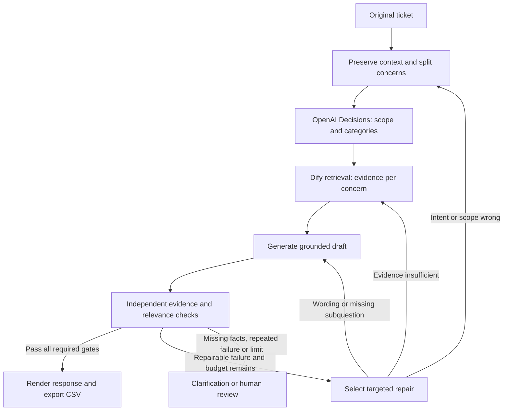

# Support RAG harness: technical proposal

Design baseline: 2026-10-11. This delivery scaffolds contracts, prompts, routing, evaluations and an implementation plan. It does not implement, deploy or benchmark the support pipeline. The existing Service API CLI remains available for later integration.

## Product objective

Produce direct, relevant support replies grounded in approved documentation. Correctly understand the requested operation and object, handle every subquestion, and ask for clarification or review when evidence is missing. The user targets at least 95% ticket resolution; measure it rather than equate it with a model's confidence or a judge's approval.

Marcus asks for the key that authenticates a call to his published Dify chatbot. The key words are useful because their relationships identify `dify_app` + `backend_call` + `key_creation_location`. An OpenAI provider-key instruction would fail relevance and object-scope checks even if it faithfully quoted another section of the same guide.

## Components and the problems they solve

| Component | Proposed tool | Problem addressed | Produced evidence |
|---|---|---|---|
| Intake and normalization | Deterministic whitespace/format cleanup plus structured generative extraction | Greetings and signatures distract retrieval; careless compression loses negation, errors or constraints | Original ticket, normalized concern, exact evidence spans |
| Concern decomposition | OpenAI structured generation or version-supported Dify LLM structured output | A single ticket may contain unrelated questions; sentiment is not intent | Separate subtickets, intent, entity/key scope, missing information |
| Routing | User-selected OpenAI Decisions via a fixed endpoint integration | Isolated keywords confuse app keys, dataset keys and model-provider credentials | Per-concern choices, topic-membership predicates and uncertainty signals |
| Evidence retrieval | Dify Knowledge Retrieval with contextual queries and soft category hints | Right topic alone does not find the passage needed to answer the operation | Source/section/revision identifiers and retrieved excerpts |
| Drafting | Dify generative LLM node with evidence-bound prompt | Generic answers, unsupported promises and omitted subquestions | Customer answer, claim/evidence map and addressed concerns |
| Independent checking | Evidence evaluator plus bounded Decisions predicates/scores | Citations can support an irrelevant answer; a second generated answer can share the same error | Separate grounding, relevance, scope, completeness and citation results |
| Repair and termination | Deterministic controller/Dify branches and bounded Loop | Repeated blind regeneration hides retrieval errors and wastes cost | Specific repair action, attempt count, final acceptance or review reason |
| Regression evaluation | Draft adjudicated cases, contrastive inputs; promptfoo recommended for later batch runs | Prompt changes can fix one ticket while breaking another | Per-case outcomes, failure types and explicit metric denominators |

The dedicated [OpenAI Decisions API](https://developers.openai.com/api/docs/guides/decisions) supports bounded judgments. Extraction and written explanations use [structured generation](https://developers.openai.com/api/docs/guides/structured-outputs?api-mode=responses). Verify beta availability and the deployed Dify integration before wiring calls; a normal OpenAI provider plugin must not be assumed to expose the Decisions endpoint. The [tool research](TOOL_RESEARCH.md) records primary documentation and GitHub candidates.

## How the stages connect

Read the [harness design](HARNESS_DESIGN.md) for states, Dify node responsibilities, prompts, failure actions and resource budgets. Role prompts are files under `agents/prompts/`, not auto-registered runnable agents. Runtime conditions, schema/citation checks and termination are controller responsibilities.

## Documentation and category mapping

The five existing categories plus `unknown` live in [category-map.json](../shared/contracts/category-map.json). They are routing hints, not mutually exclusive document partitions. The guide contains four sections; API access and workspace membership share §1, while API caps, memberships, credits and storage also require §4. Keep cross-section retrieval available and all secondary topics in the trace. The export's one category follows the first explicit actionable concern convention; baseline labels remain provenance.

Ingest the fictional [product guide](../knowledge/sources/product-guide.md) and the narrowly scoped [API transport supplement](../knowledge/sources/api-transport-supplement.md). The supplement supports Bearer transport in the requested example without changing fixture prices or entitlements. Exclude noisy ticket answers from retrieval. The [evidence manifest](../shared/contracts/evidence-sources.json) tracks revisions.

Initially keep the product guide intact and inspect chunks/table preservation. Dify's documented [metadata filtering](https://docs.dify.ai/en/self-host/use-dify/knowledge/metadata) is at document level; section routing in this file requires an explicit evidence map or approved section-level ingestion. The harness design records this deployment check rather than claiming per-chunk filters exist automatically.

## Contracts and the requested output

The canonical [JSON Schema](../shared/schemas/harness.schema.json) defines stage records and a completed-attempt envelope. Schema validation proves shape only. The controller must also check original-span offsets, legal category values, known source IDs, claim-to-evidence relationships, every subticket's coverage, pass/failure consistency and the attempt limit.

The [Decisions request example](../shared/contracts/openai-decisions-request.example.json) shows a real documented request shape with fixed questions and categories. It has not been sent. Questions are trusted configuration; ticket/retrieved text belongs in `input` and cannot redefine instructions. Match answers by name and type; handle refusals, malformed/missing questions and provider failures without approving the draft.

The [Marcus understanding example](../shared/fixtures/marcus-understanding.example.json) demonstrates scope extraction. The [Marcus CSV example](../shared/fixtures/marcus-output.example.csv) preserves the user's requested prose with exactly `ticket_text,assistant_answer,category` columns. It is illustrative, not a measured model output or adjudicated benchmark score. Its [provenance sidecar](../shared/fixtures/marcus-example-provenance.json) identifies the evidence required. Internal citations, disposition, subtickets, versions and attempts stay in a linked trace sidecar.

## Evaluator and retry design

The optional dummy/reference answer should be derived independently from the same question and approved evidence. Treat it as a hypothesis to inspect, not an authority. Prefer a reviewed requirement set over text similarity: correct key kind, correct key location, relevant steps, supported scope and no provider-key substitution. The evaluator must flag a wrong passage even when the citation is genuine.

Retries change the stage responsible for failure. Wrong scope triggers reanalysis; missing relevant chunks expands/rephrases retrieval; unsupported wording with adequate evidence redrafts; missing customer facts clarifies; uncovered policy escalates. Allow at most three total draft attempts. A repeated identical failure, judge disagreement or exhausted cost/time budget terminates for review. The exact numeric probability thresholds remain calibration decisions, not promises.

## Testing and the 95% objective

The [evaluation plan](EVALUATION_PLAN.md) separates retrieval sufficiency, answer correctness, relevance, abstention, format and end-to-end resolution. All 26 original tickets have draft adjudication records; holdout proposals cover scope contrasts, negation, ambiguous tickets, unrelated evidence, multi-topic inputs and injection attempts. Draft cases need human review before being called gold. No model-quality run is included in this scaffold.

Report strict resolved/all tickets, strict resolved/answerable tickets and safe handling/all tickets separately. A correct clarification or escalation is safe handling; it does not prove the ticket was resolved. These files contain undocumented Enterprise configuration and ambiguous requests, so the 95% goal may require a broader approved corpus and representative evaluation data. At this size, one ticket changes the overall rate by about 3.85 percentage points; no broad reliability claim is warranted.

## Implementation sequence after design refinement

1. Review contracts, category conventions, draft adjudications and the Marcus expected output. Select Dify deployment/version and OpenAI model access; benchmark generation choices rather than assume a model ranking.
2. In a disposable target app, create the smallest intake → understanding → Decisions → retrieval → answer → evaluator flow. Use deterministic fixtures for provider failures and explicit version-supported nodes. Export a sanitized DSL only after it exists and runs.
3. Implement the fixed-host Decisions adapter in an existing backend if available, or verify a secret-backed Dify HTTP Request integration. Keep authorization and controller checks outside model prompts; do not add an unrelated service just for architecture.
4. Add bounded repairs, trace records and the exact CSV exporter. Separate provider transport failures from semantic repairs. Verify one real end-to-end request and the negative scope tests.
5. Run adjudicated development cases, tune routing/retrieval thresholds, then freeze them for holdout evaluation. Inspect failed cases and report measured rates before expanding deployment.

Docker deployment and real container round trips become required when a new runnable service is introduced. No service, paid API request, upload, ticketing writeback or live deployment is included in this design delivery.
